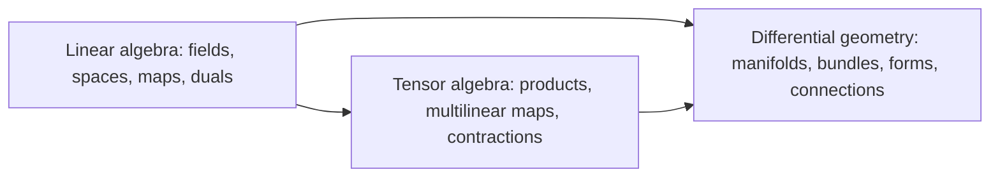
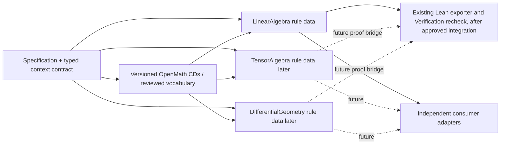

# Target architecture for abstract mathematical rules

Research/design only. LinearAlgebra, TensorAlgebra and DifferentialGeometry
are all mandatory **target responsibilities**; only the linear-algebra pilot
is a candidate for the first implementation. No implementation of any of the
three domains, no repository creation and no change to the official
specification is authorized by this research phase. See
[recon](recon.md), [schema proposal](schema-proposal.md),
[linear rule design](rule-design.md), [Mathlib mapping](mathlib-mapping.md)
and [interoperability](interoperability.md).

## Four distinct representation levels

1. **Typed abstract object:** `u : V`, `f : V → W`, `A : Mat(F,m,n)`, a
   tensor in a specified tensor space, or a differential form on `M`.
2. **Structure and properties:** linearity, dimensional equalities,
   invertibility, a metric, orientation, manifold smoothness and connection;
   these belong to a context and may be unknown.
3. **Indexed/coordinate representation:** bases, variances, charts and
   coordinate transformations, explicitly connected to levels 1–2.
4. **Components/numerical values:** arrays in a chosen basis or chart, usable
   for testing or numerical execution, not the sole meaning of a rule.

Mathlib's matrix carrier can implement a finite matrix as a function of two
indices while the *rule* remains at levels 1–2; this is not the same as
requiring an engine to expand a symbolic `A` to components. Coordinate-free
linear maps and tensors must not be conflated with their component matrices.

## Mathematical dependency graph

This describes mathematical prerequisites, not a package-import mandate.
Tensor associativity is via a canonical associator/equivalence unless a
representation makes strict associativity an explicit reviewed convention.
Geometry is not merely tensor arrays: sections live over a base manifold;
pullbacks and covariant derivatives have type, smoothness and locality rules.

## Proposed software and evidence flow

The producer remains CAS-independent. A mathematical dependency on a vector
space concept does not require a source-code dependency on a specific domain
repository or on Julia. Common vocabularies and proof libraries are shared by
versioned specification interfaces. No universal JSON-to-Lean tool currently
exists in the inspected OSR infrastructure; a compatible typed bridge is a
design decision requiring approval. A common specification should expose
three-valued condition checking, qualified symbol identities, proof
provenance, exact statement auditing and deterministic profiles.

## Fifteen conceptual proof-of-concept rules

Every row below is **proposed**, not an executable v1 rule. `Plan` means a
formalization plan, not a checked proof. `+` and `−` are *test designs*, not
executed tests. For types not supported by v1, `representation` is a
mathematical schematic using labels such as `compose` or `d`; these labels are
not claimed OpenMath symbols. Each is a typed abstract statement and does not
need component expansion. All mappings require a reviewed typed context and
symbol interpretations; the [actual linalg1 vocabulary](https://openmath.org/cd/linalg1.html)
provides `transpose` where noted.

| # / domain | Statement and sufficient hypotheses | Representation / Lean plan | Positive test → expected | Negative or invalid-application test → expected |
|---|---|---|---|---|
| 1 LA | `(AB)C = A(BC)`; `A:m×n`, `B:n×p`, `C:p×q`, same commutative scalar field | Nested `arith1#times`; candidate `Matrix.mul_assoc`; typed interpretation needed. | `2×3`, `3×4`, `4×5` → both `2×5`. | `A:2×3`, `B:4×5` → reject mismatch. |
| 2 LA | `A(B+C)=AB+AC`; compatible shapes and same scalar structure | `arith1#times`/`arith1#plus`; candidate `Matrix.mul_add`. | `A:2×3`, `B,C:3×4` → type `2×4`. | `B:3×4`, `C:3×5` → reject sum. |
| 3 LA | `(AB)^T=B^TA^T`; compatible matrices over ℝ/ℂ | Actual `linalg1#transpose` + `arith1#times`; candidate `Matrix.transpose_mul`. | `A:2×3`, `B:3×4` → both `4×2`. | Swap `A^TB^T` blindly → reject/wrong order. |
| 4 LA | `(g∘f)(u)=g(f(u))`; linear maps `f:U→V`, `g:V→W`, `u∈U` | Conceptual map composition/application; inspect exact `LinearMap` declarations at implementation. Current v1 generally disallows an arbitrary expression in applicant position. | Compatible `U,V,W` → output in `W`. | `f:U→V`, `g:X→W`, `V≠X` → reject. |
| 5 LA | `A u∈F^m`; `A:m×n`, `u∈F^n` | Typing judgment for matrix-vector application, candidate `Matrix.mulVec`; not itself an equality rewrite. | `A:2×3`, `u:3` → `2`. | `u:4` → reject. |
| 6 LA | `L(u+v)=L(u)+L(v)`; `L:V→W` linear, `u,v∈V` | Conceptual typed map application; plan with `LinearMap` map-add law after lookup. | Linear `L`, same `V` → apply. | An arbitrary nonlinear `f` or `v∈W` → reject. |
| 7 Tensor | `α((u⊗v)⊗w)=u⊗(v⊗w)`; modules over a commutative base and the specified associator `α` | Conceptual tensor product and associator, not invented `OMS`; inspect pinned `TensorProduct` equivalence. | `u∈U,v∈V,w∈W` → apply chosen associator. | Drop `α` and assert type equality without a strict convention → reject. |
| 8 Tensor | `contract(v⊗φ)=φ(v)`; `v∈V`, `φ∈V*`, pairing specified | Conceptual evaluation/contract; inspect `LinearMap` and tensor universal-property declarations. | Matching `V` and its dual → scalar. | `v∈V`, `φ∈W*` without a map `V→W` → reject. |
| 9 Tensor | `τ(S)=S`, `τ(K)=-K`; symmetric `S` and antisymmetric `K` under the same swap `τ` | Conceptual typed permutation and proven symmetry predicates; plan with tensor linear equivalence. | Declared/proved symmetric `S` → rewrite. | Arbitrary `T` without symmetry evidence → do not rewrite. |
| 10 Tensor | `g♭⁻¹(g♭(v))=v`; finite-dimensional `V`, specified nondegenerate bilinear metric `g`, chosen inverse | Conceptual musical maps `g♭`, inverse; inspect bilinear-form equivalences. | Nondegenerate `g` → inverse laws. | Degenerate `g` or inverse not established → reject. |
| 11 Geometry | `d(α+β)=dα+dβ`; smooth forms of the same degree on the same manifold | Conceptual exterior derivative and form addition; find exact pinned formalization before claiming support. | Two smooth 1-forms on same `M` → smooth 2-forms. | Forms on unrelated manifolds → reject. |
| 12 Geometry | `d(dω)=0`; sufficiently smooth differential form `ω` | Conceptual typed exterior derivative; formalization/library coverage unverified. | Smooth degree-`p` form → zero degree `p+2`. | Arbitrary non-form object or missing regularity → do not apply. |
| 13 Geometry | `d(α∧β)=dα∧β+(-1)^p α∧dβ`; `deg α=p`, smooth forms on same `M` | Conceptual `d`, `wedge`, degree and scalar sign; pinned theorem unverified. | `p=1` → negative second term. | Use sign `+` for odd `p` or mismatched base → reject. |
| 14 Geometry | `∇_X(fY)=X(f)Y+f∇_X Y`; fixed connection, smooth scalar `f` and vector fields `X,Y` | Conceptual connection/derivation context; relevant Mathlib covariant-derivative files exist, exact theorem unverified. | Same bundle and smooth inputs → apply. | Omit `X(f)Y` or mix connections/manifolds → reject. |
| 15 Geometry | `R(X,Y)Z=-R(Y,X)Z`; smooth connection, `R(X,Y)Z=∇_X∇_Y Z−∇_Y∇_X Z−∇_[X,Y]Z` | Conceptual curvature with explicitly recorded sign convention; exact Mathlib theorem/support unverified. | Same connection and valid fields → apply. | Treat `R` as symmetric in `X,Y`, or mix curvature conventions without translation → reject. |

For Levi-Civita curvature one may additionally design pair symmetries,
contractions and Bianchi rules after fixing metric, connection, slot order and
sign convention. A general affine connection does **not** imply all Riemannian
curvature symmetries. The 15 rows are research coverage; the 28-rule pilot
inventory is separately counted and remains linear-algebra-only.

## Domain repository proposals

| Responsibility | Scope and exclusions | Dependencies / first families | Acceptance and timing |
|---|---|---|---|
| LinearAlgebra | Abstract matrices, vector spaces, linear maps, shape and noncommutative products. Excludes a CAS, tensor/index engine and geometry implementation. | Shared type/condition vocabulary; reviewed OpenMath matrix operations; Lean `Matrix`/`LinearMap`; first families in [rule design](rule-design.md). | Create/activate as a pilot **only after review and authorization**. Shape checks, false witnesses, deterministic numerical tests, semantic-bridge proofs and reproducible independent audit required. |
| TensorAlgebra | Tensor products, multilinear maps, duals, associators, variance and contractions. Excludes manifold-specific fields and array-only semantics. | Mathematical dependence on vector spaces/duals; shared context and vocabulary; proof mapping for tensor products and equivalences. | Target repository after the typed linear pilot; demonstrate typed contraction and associator, invariants and negative cases. |
| DifferentialGeometry | Intrinsic manifolds, bundles/fields, forms, pullback, connections, curvature and convention-aware identities. Excludes a mere Christoffel/array rewriter and numerical PDE engine. | Mathematical dependence on linear/tensor structures, smoothness and local/global scope; audited Mathlib manifold/geometry coverage. | Mandatory target repository after tensor/typing foundations; demonstrate coordinate-independent rules, convention-aware proof and cross-chart tests. |

Each later repository would use `README.md`, `docs/` (foundations, vocabulary,
interoperability), `rules/`, `refuted/`, `tests/`, `reports/`, CI and a
`justfile` only after the shared format and proof bridge are agreed. The
mathematical edges above do not require a hard repository runtime dependency.
Use existing `Specification`, `Lean`, `Verification`, `Conformance`, and
OpenMath resources instead of creating duplicate registries or proof systems.
No fourth domain repository is justified by this research. Existing OSR
repositories should be extended **only with explicit authorization**.

## Concrete application workflows

* **Mathematics:** a type checker validates composition of maps and tensor
  contraction before a basis is chosen; a proof record separates equalities
  from a normalizer's termination and matching strategy.
* **Physics:** general relativity keeps metric, connection and curvature sign
  conventions attached while deriving intrinsic statements, then converts to
  chart components. Electromagnetism can use exterior-form identities before
  selecting coordinates. Quantum/operator algebra must retain product order.
* **Engineering and control:** state-space identities preserve dimensions of
  `A,B,C` and domain/codomain of transformations; robotics preserves frames
  and composition order. Numerical simulation is a downstream consumer, not
  evidence that a symbolic identity is universally valid.

These are research opportunities, not demonstrated existing OSR features.
The [MathML/OpenMath standard material](https://openmath.org/standard/om20-2004-06-30/omstd20.pdf),
[Mathlib](https://github.com/leanprover-community/mathlib4), and the
vendor documentation linked in [interoperability](interoperability.md) are
starting points, not evidence of automatic compatibility.

## EARS requirements and MoSCoW roadmap

### Must — foundation and safety

* **M1, ubiquitous:** The format shall bind each rule variable to an
  unambiguous scalar, space, map or shaped-object type.
* **M2, event-driven:** When a product is matched, the checker shall establish
  compatible dimensions and preserve operand order.
* **M3, unwanted behavior:** If a symbol, type, condition or dimension is
  unknown or unproved, the consumer shall refuse the dependent rewrite.
* **M4, event-driven:** When an inverse rule is considered, the checker shall
  require the stated invertibility and scalar-nonzero premises.
* **M5, event-driven:** When a proof is published, the existing audit shall
  check the exact statement, approved semantic mappings, axioms and source
  digest; numerical tests shall not certify the rule.
* **M6, ubiquitous:** The ecosystem shall preserve existing scalar v1 files,
  conformance cases and semantics; extensions require an explicit version and
  negotiation.
* **M7, event-driven:** When a counterexample is reported, the witness shall
  satisfy the rule's own premises and its differing values shall be shown.

### Should / could / won't

* **Should:** collect representative rules in all six linear families; map
  proof declarations; run deterministic numerical checks, negative type tests,
  theorem compilation and replay; document CAS capability gaps.
* **Could:** add proof-carrying assumption evidence and interoperability
  prototypes after the core contract is stable.
* **Won't in this pilot:** implement tensor indices/contractions, geometry,
  explicit arrays as canonical rules, a new CAS, unchecked fallback symbols,
  unconditional matrix exponential splitting, or a Julia-specific format.

Sequence without dates: (1) approve type, vocabulary, compatibility and proof
boundary; (2) implement/test a small linear pilot under separately authorized
scope; (3) extend tensor structures and associators; (4) add differential
geometry with base-manifold and connection conventions; (5) expand proof and
CAS conformance in each stage. Numerical checks precede proof generation, not
vice versa.

## Risks, open decisions and recommendation

Key risks are untyped sidecars being ignored; accidental AC matching; CD
ambiguity and experimental status; false confidence from Mathlib's totalized
inverse; complex logarithm/exponential branch or norm conventions; scalar vs
matrix domain conflation; basis/chart and orientation leakage; proof-statement
drift; nontermination from opposing orientations; and source-history/report
growth. Independent rechecks must measure CD-to-Lean mapping assurance as well
as kernel validity.

After a reviewed LinearAlgebra pilot, **TensorAlgebra is the recommended next
implementation**, because duals, multilinearity, typed products and
contraction are prerequisites for intrinsic geometry. DifferentialGeometry
remains a required target, not an optional idea: it must independently design
manifold, bundle, smoothness and connection semantics on top of those shared
foundations. Neither repository needs to be created during this research.
